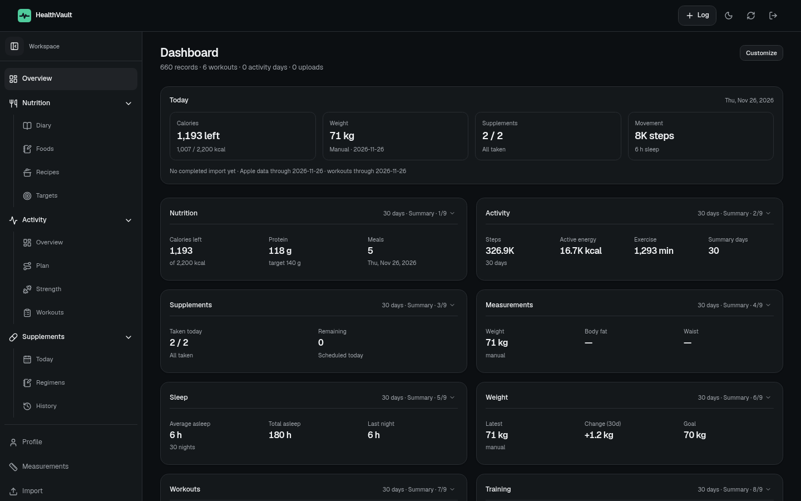
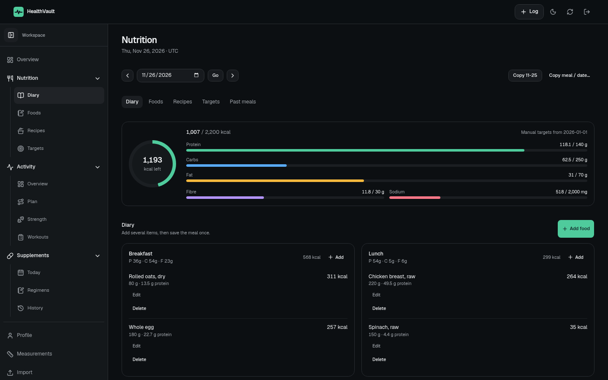
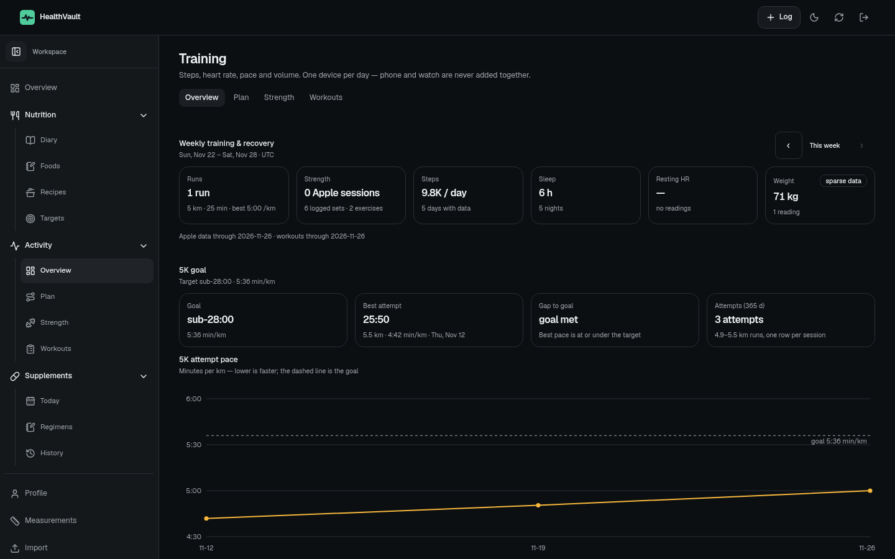
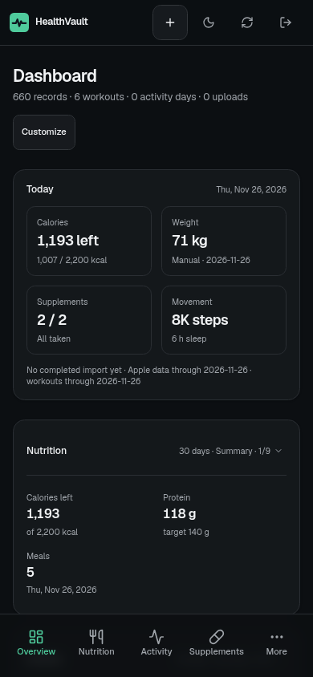

# HealthVault

[](https://github.com/tunitz/healthvault/actions/workflows/ci.yml)
[](https://github.com/tunitz/healthvault/actions/workflows/release.yml)
[](LICENSE)
[](https://github.com/tunitz/healthvault/pkgs/container/healthvault)
[](https://bun.sh/)

A self-hosted, single-user personal health, nutrition, training, and Apple Health analytics dashboard backed by a local SQLite database and an integrated Model Context Protocol (MCP) server.



## Features

| Area | Capabilities | Routes |
| --- | --- | --- |
| **Apple Health Import** | Streaming `Export.zip` ingest (records, workouts, GPX routes & km splits, Apple Watch ECG waveforms, activity rings) with single-source-per-day deduplication | `/`, `/workouts`, `/workouts/[id]`, `/explorer`, `/uploads` |
| **Profile & Measurements** | Personal profile, IANA timezone (`UTC` default), metric/imperial units, work schedule, 5K goal, manual weight/body-fat/waist merged with Apple `BodyMass` | `/profile`, `/measurements` |
| **Nutrition & Recipes** | Calorie & macro diary, food library, household measures, raw/cooked/dry yield templates, immutable per-ingredient meal snapshots, scoped history corrections | `/nutrition`, `/nutrition/foods`, `/nutrition/recipes`, `/nutrition/targets`, `/nutrition/corrections` |
| **Training & Strength** | 16-week running/training block planner, strength set logging, 5K attempt progression, weekly recovery summary | `/training`, `/training/plan`, `/training/strength` |
| **Supplements** | Scheduled supplements, adherence tracking, atomic one-tap whey protein logging & undo | `/supplements`, `/supplements/regimens`, `/supplements/history` |
| **AI / MCP Integration** | 53 tools, 4 resources, and 3 prompts over stdio (`healthvault-mcp`), Streamable HTTP (`POST /api/mcp`), and REST (`POST /api/agent/<tool>`) | `/settings/mcp` |
| **Security & Backups** | Mandatory single-user auth (first-run `/setup` or `.env`), Host/Origin checks, offline-capable PWA, WAL-safe SQLite online backups & JSON/CSV export | `/setup`, `/login`, `/settings/*` |

## Screenshots

| Nutrition Diary & Macros | Training & 5K Progression | Mobile PWA |
| :---: | :---: | :---: |
|  |  |  |

## Architecture

```text
Browser / PWA  <──(hv_session cookie)──>  Next.js 16 App & API  <──>  SQLite (WAL, mode 0600)
                                                 ▲
MCP Client / Agent  <──(Bearer token / stdio)────┘  (/api/mcp, /api/agent/*, healthvault-mcp)
```

All rolling "today" and "last N days" queries evaluate against the profile's IANA timezone rather than UTC `date('now')`, and Apple Health steps, heart rate, and active energy automatically select one device source per day so iPhone and Apple Watch samples never double-count. See [docs/architecture.md](docs/architecture.md) for streaming ingest and schema details.

## Quick Start

### 1. Docker Compose (Recommended)

The official multi-stage Alpine image runs the standalone Next.js server on Node 22 as UID/GID `1000:1000` on port `3040`, storing SQLite data under `./data`:

```bash
git clone https://github.com/tunitz/healthvault.git && cd healthvault
cp .env.example .env
# Generate a password hash and session secret into .env (mode 0600):
bun run password:set
# Or edit .env manually and set HEALTHVAULT_PASSWORD_HASH, HEALTHVAULT_SESSION_SECRET, and HEALTHVAULT_ALLOWED_HOSTS.

mkdir -p data
docker compose pull
docker compose up -d
```

Open <http://localhost:3040>. To build locally from source instead of pulling from GHCR:

```bash
docker compose -f compose.yaml -f compose.build.yaml up -d --build
```

### 2. Prebuilt Release Archive

Download `healthvault-<tag>-linux-x64.tar.gz` and `SHA256SUMS.txt` from [GitHub Releases](https://github.com/tunitz/healthvault/releases):

```bash
sha256sum -c SHA256SUMS.txt --ignore-missing
tar -xzf healthvault-*-linux-x64.tar.gz && cd healthvault
cp .env.example .env   # fill in HEALTHVAULT_PASSWORD_HASH, HEALTHVAULT_SESSION_SECRET, HEALTHVAULT_ALLOWED_HOSTS
NODE_ENV=production PORT=3040 HOSTNAME=0.0.0.0 node server.js
```

### 3. From Source

Requires **[Bun](https://bun.sh/) >= 1.4.2**:

```bash
git clone https://github.com/tunitz/healthvault.git && cd healthvault
bun install --frozen-lockfile
bun run build
PORT=3040 HOSTNAME=127.0.0.1 bun run start
```

On first visit, open `/setup` in the browser to create your password (or pre-seed `.env` beforehand with `bun run password:set`).

## Authentication & Configuration

There is **no auth-off mode**. Authentication operates in three states:

1. **`unconfigured`** — Fresh install with no SQLite or `.env` credentials redirects to `/setup` until an owner password is created.
2. **`legacy` (`.env`)** — Credentials loaded from `HEALTHVAULT_PASSWORD_HASH` and `HEALTHVAULT_SESSION_SECRET` (generated via `bun run password:set`).
3. **`stored` (SQLite `auth_credentials`)** — Created via `/setup`, **Settings → Account**, or token rotation in **Settings → MCP**. Once active in SQLite, stored credentials take precedence over `.env`.

### Environment Variables

| Variable | Default | Description |
| --- | --- | --- |
| `DATABASE_PATH` | `./data/health.db` | SQLite database path (empty string fails fast; dir `0700`, file `0600`). |
| `HEALTHVAULT_PASSWORD_HASH` | unset | `scrypt:N:r:p:salt:hash` for `.env`-backed auth (`bun run password:set`). |
| `HEALTHVAULT_SESSION_SECRET` | unset | HMAC-SHA256 secret (≥ 32 chars) for `hv_session` cookies. |
| `HEALTHVAULT_API_TOKEN` / `HEALTHVAULT_API_TOKEN_FILE` | unset | Bearer token (or `0600` token file path) for `/api/agent/*` and `/api/mcp`. |
| `HEALTHVAULT_ALLOWED_HOSTS` | `localhost,127.0.0.1,::1` | Exact comma-separated hostnames/IPs allowed by the Host guard (never `*`). |
| `HEALTHVAULT_DEFAULT_TIMEZONE` | `UTC` | Default IANA timezone for newly created profiles (also respects `TZ`). |
| `HEALTHVAULT_TRUST_PROXY` | unset | Set `1` behind a trusted TLS reverse proxy so client IP checks read `X-Forwarded-For`. |
| `HEALTHVAULT_COOKIE_SECURE` | unset | Set `1` when serving over HTTPS so `hv_session` is marked `Secure`. |
| `HEALTHVAULT_DEV_ORIGINS` | unset | Comma-separated extra origins allowed during `next dev`. |

## AI & MCP Integration

Install the stdio MCP server once from the checkout (`bun install -g ./plugins/healthvault`), or connect directly over Streamable HTTP at `POST /api/mcp` with `Authorization: Bearer <token>`.

- [plugins/healthvault/README.md](plugins/healthvault/README.md) — OpenCode, Claude Code, Claude Desktop, and Cursor setup snippets.
- [docs/mcp-and-api.md](docs/mcp-and-api.md) — Full 53-tool inventory, MCP resources/prompts, food templates, and snapshot contracts.

## Backup, Restore & Security

- **WAL-safe backups**: Run `bun run db:backup` (writes a `PRAGMA integrity_check`-verified copy under `data/backups/` with mode `0600`) or download from **Settings → Data tools** (`GET /api/backup`). Under Docker, run `sqlite3 data/health.db ".backup 'healthvault-backup.db'"` or stop the container before archiving `data/`.
- **Restore**: Stop HealthVault, replace `data/health.db`, delete any stale `-wal`/`-shm` sidecars, and start again.
- **Security**: Keep HealthVault on loopback or a trusted LAN, or terminate TLS in front ([deploy/Caddyfile.example](deploy/Caddyfile.example)) with `HEALTHVAULT_COOKIE_SECURE=1`. See [SECURITY.md](SECURITY.md) for the full security model and vulnerability reporting.

## Documentation

- [docs/architecture.md](docs/architecture.md) — Streaming ingest design, parsing rules, and repository layout
- [docs/mcp-and-api.md](docs/mcp-and-api.md) — Agent API, MCP tools, resources, prompts, and nutrition snapshot rules
- [docs/ingredient-snapshots-handoff.md](docs/ingredient-snapshots-handoff.md) — Cross-stack ingredient snapshot specification
- [plugins/healthvault/README.md](plugins/healthvault/README.md) — `@healthvault/mcp` server setup
- [deploy/README.md](deploy/README.md) — Linux systemd deployment & Caddy reverse proxy guide

## Contributing & Verification

Contributions are welcome — see [CONTRIBUTING.md](CONTRIBUTING.md) for branching, Conventional Commits, and local test commands:

```bash
mkdir -p /tmp/opencode
bun run typecheck && bun run lint && bun test --isolate && bun run build
```

## License

[MIT](LICENSE) © 2026 tunitz
