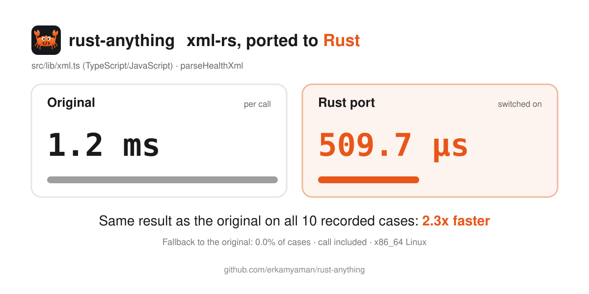

## `xml-rs` in Rust

| | |
| --- | --- |
| Unit | `src/lib/xml.ts` (TypeScript/JavaScript) |
| Recorded cases matched | 10 / 10 |
| Speedup, call included | 2.3x (geometric mean) |
| Fallback to the original | 0.0% (0 of 10 cases) |
| Switched on | on |

| Function | Cases | Original per call | Rust per call | Speedup |
| --- | ---: | ---: | ---: | ---: |
| `parseHealthXml` | 10 | 1.2 ms | 509.7 µs | 2.3x |

Measured with `rust-anything report` on AMD Ryzen 5 7600X 6-Core Processor, 12 cores, Linux: `diff` replays every recorded case, `bench` times them on both sides as callers call them. Reproduce: `rust-anything diff` and `rust-anything bench` in the crate folder.
